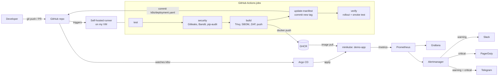
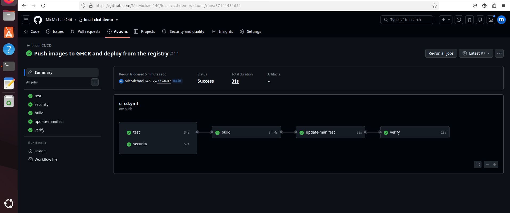
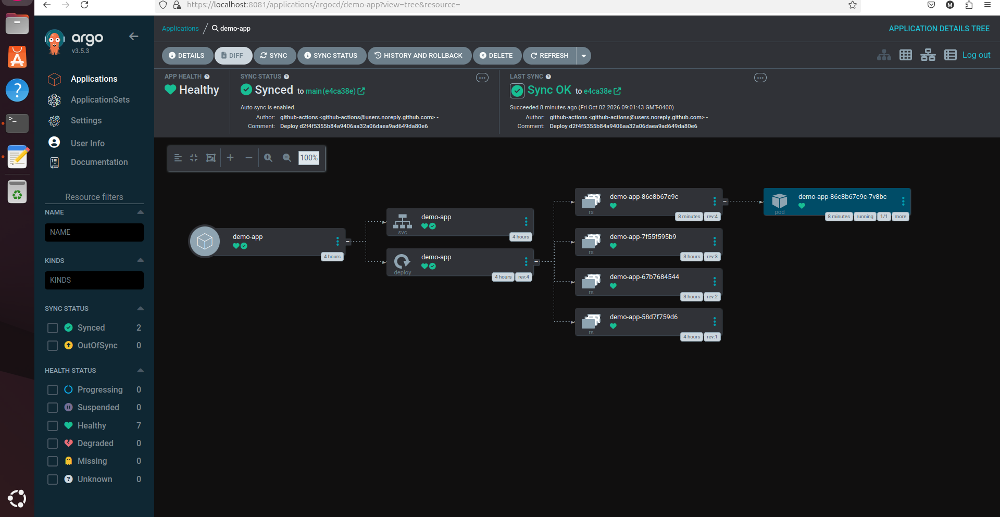
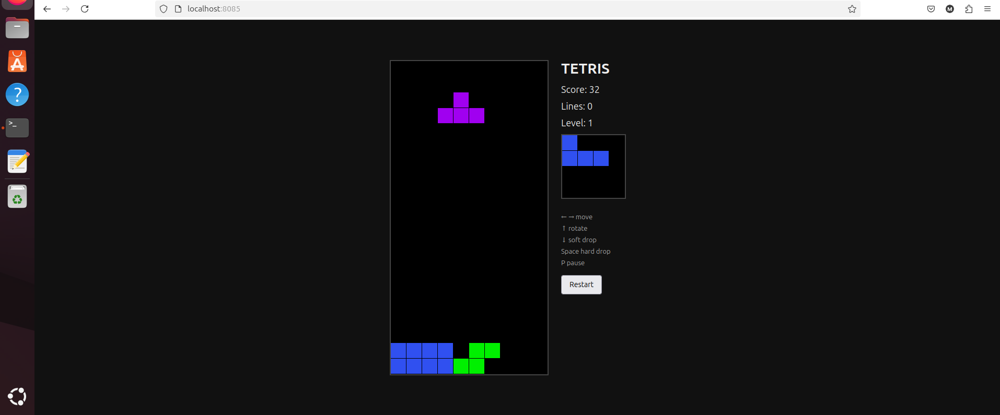
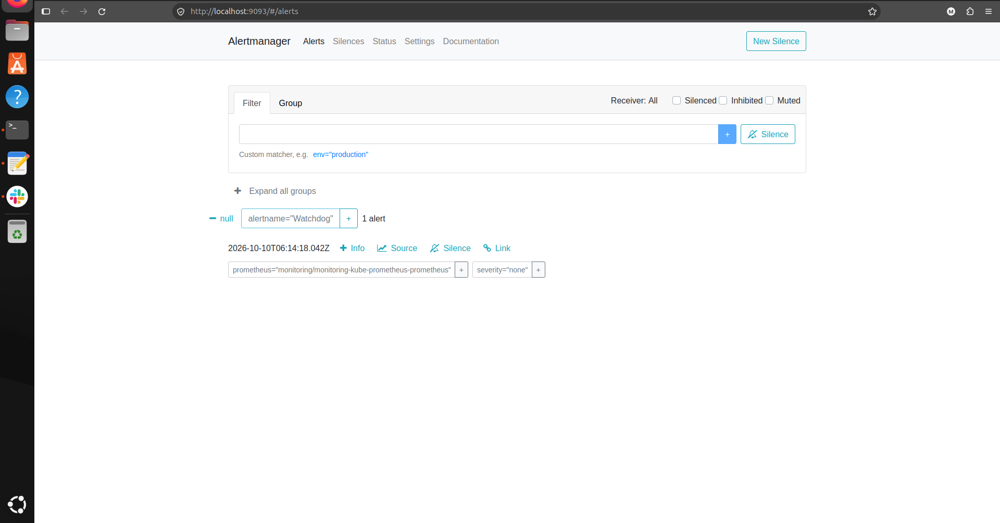
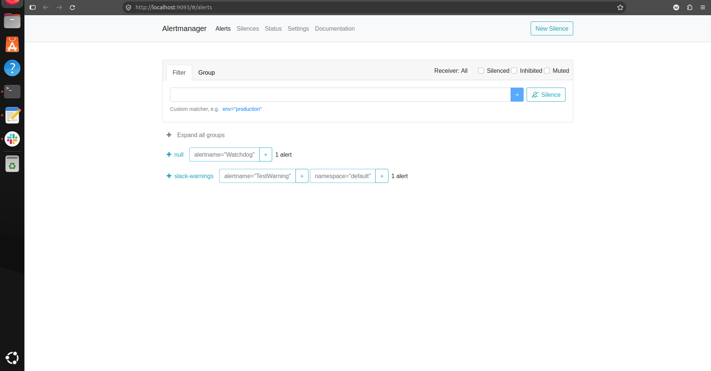
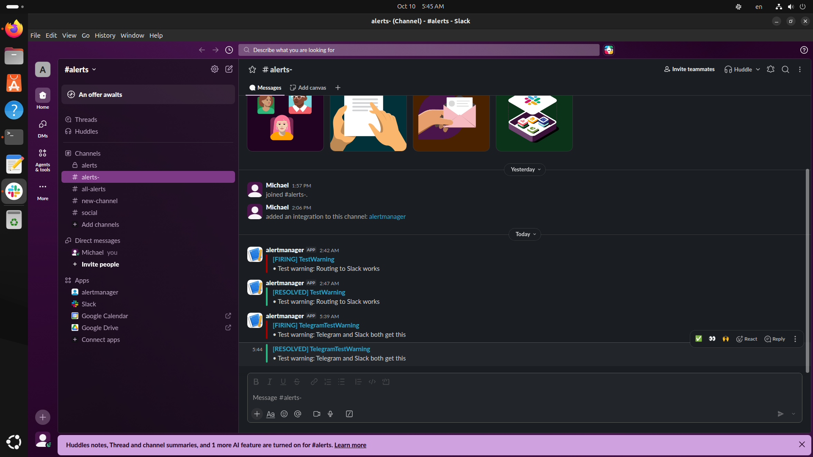
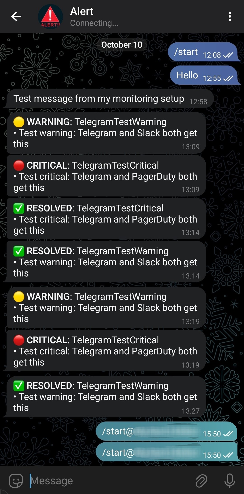
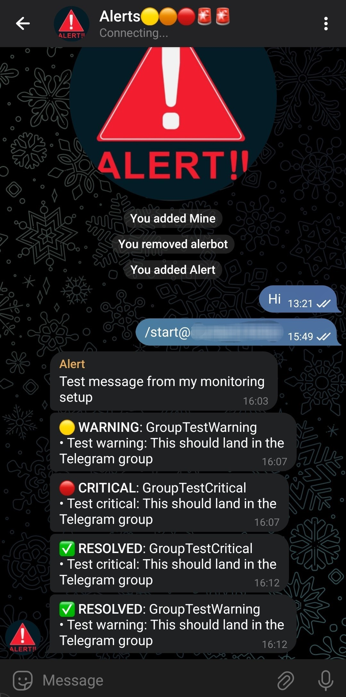

# local-cicd-demo: a DevSecOps pipeline that runs entirely on one machine


A complete, production-style delivery pipeline for a small Python (Flask) app, built **without any cloud account**.
Every push to `main` is tested, security-scanned, built into a container image, published to GitHub Container Registry (GHCR),
and deployed to a local Kubernetes cluster (minikube) through GitOps (Argo CD). The running app is monitored with
Prometheus and Grafana, and alerts are routed to Slack, PagerDuty and Telegram.

This README is both a **showcase** and a **tutorial**: every stage lists the exact commands, the files, how to verify it,
and (near the end) the real problems I hit while building it and how I fixed them.

> Everything here was built and tested on a single Linux VM (Ubuntu-style, hostname `osboxes`) with a slow, sometimes flaky
> internet connection. That is why you will see retries, long timeouts and pinned images. They are there for a reason.

## Contents

- [Overview](#overview)
- [Architecture](#architecture)
- [Results](#results)
- [Repository layout](#repository-layout)
- [Stage 0: Prerequisites](#stage-0-prerequisites)
- [Stage 1: The application](#stage-1-the-application)
- [Stage 2: Container image](#stage-2-container-image)
- [Stage 3: Kubernetes manifests](#stage-3-kubernetes-manifests)
- [Stage 4: GitHub repository and self-hosted runner](#stage-4-github-repository-and-self-hosted-runner)
- [Stage 5: Argo CD (GitOps)](#stage-5-argo-cd-gitops)
- [Stage 6: The CI/CD pipeline](#stage-6-the-cicd-pipeline)
- [Stage 7: Security scanning](#stage-7-security-scanning)
- [Stage 8: DAST and hardening](#stage-8-dast-and-hardening)
- [Stage 9: Supply-chain security](#stage-9-supply-chain-security)
- [Stage 10: Pull request workflow](#stage-10-pull-request-workflow)
- [Stage 11: Monitoring and alerting](#stage-11-monitoring-and-alerting)
- [Verification checklist](#verification-checklist)
- [Problems I hit and how I fixed them](#problems-i-hit-and-how-i-fixed-them)
- [Day-to-day operation](#day-to-day-operation)
- [Limitations](#limitations)
- [Roadmap](#roadmap)
- [Cleanup](#cleanup)
- [Appendix A: Complete workflow file](#appendix-a-complete-workflow-file)

## Overview

**Goal:** a pipeline where "build" means *my* machine builds the image, "deploy" means *my* minikube cluster runs it,
and nothing needs a cloud provider.

What it demonstrates:

| Area | What is implemented |
|---|---|
| CI | GitHub Actions on a **self-hosted runner** (jobs: test, security, build, update-manifest, verify) |
| CD | **GitOps** with Argo CD: the pipeline only commits a new image tag; Argo CD applies it |
| Registry | Images pushed to **GHCR** (`ghcr.io/micmichael246/demo-app:<commit-sha>`) |
| SAST / secrets / SCA | Gitleaks, Bandit, pip-audit |
| Container security | Trivy image scan, Trivy config (IaC) scan, SBOM (CycloneDX) |
| DAST | OWASP ZAP baseline scan against the freshly built container |
| Hardening | Non-root user, read-only filesystem, dropped capabilities, seccomp, strict CSP and security headers, gunicorn |
| Supply chain | Images and actions pinned by digest/SHA, Dependabot, optional cosign signing and Kyverno verification |
| Monitoring | kube-prometheus-stack: Prometheus, Grafana dashboard, alert rules |
| Alerting | Alertmanager: warning to Slack and Telegram, critical to PagerDuty and Telegram |

## Architecture



### Components

| Component | Role | Where it runs |
|---|---|---|
| GitHub | Source of truth (code **and** desired cluster state in `k8s/`) | github.com |
| Self-hosted runner | Executes every job | my VM |
| Docker | Builds the image, runs scanners | my VM |
| GHCR | Stores images | github.com (`ghcr.io`) |
| minikube | Local Kubernetes cluster | my VM (Docker driver) |
| Argo CD | Syncs `k8s/` from Git into the cluster | minikube, namespace `argocd` |
| kube-prometheus-stack | Prometheus, Alertmanager, Grafana | minikube, namespace `monitoring` |

### How a change reaches the cluster

1. `git push` to `main` (or merge a PR).
2. Pipeline runs: tests, security gates, image build, scans, DAST. Any failure stops the pipeline **before** anything is published.
3. The image is pushed to GHCR tagged with the commit SHA.
4. The pipeline edits the `image:` line in `k8s/deployment.yaml` and commits it (`paths-ignore` prevents a loop).
5. Argo CD sees the new commit and rolls out the new image.
6. The `verify` job waits for the rollout and calls `/health`.

> The pipeline never runs `kubectl apply` for the app. Argo CD is the only thing that changes the cluster. That is the point of GitOps.

## Results

What the pipeline and the cluster reported when I ran it:

| Check | Result |
|---|---|
| Unit tests (pytest) | 5 passed |
| Gitleaks | 15 commits scanned, no leaks |
| Bandit (`-ll`) | clean |
| pip-audit | no known vulnerabilities |
| Trivy image scan (CRITICAL) | 0 vulnerabilities (OS and Python packages) |
| Trivy config scan | clean after hardening (see [Problems](#problems-i-hit-and-how-i-fixed-them)) |
| OWASP ZAP baseline | 0 fail, 0 warn, 65 pass (2 rules deliberately ignored) |
| Argo CD application | `Synced` / `Healthy`, running gunicorn 26.2.0 |
| Prometheus | `demo-app` target `up`, 5 alert rules loaded and `ok` |
| Slack | warning alerts delivered (firing and resolved) |
| Telegram | warning, critical and resolved alerts delivered to a private chat and to a group |

### Screenshots

**Pipeline run:** all five jobs green (test, security, build, update-manifest, verify).



**Argo CD:** `demo-app` is `Healthy` and `Synced`, with the Deployment, Service and ReplicaSets created from Git.



**The deployed app** (Tetris, served from the minikube cluster):



**Alertmanager:** only the always-firing `Watchdog` goes to the `null` receiver when idle; a test warning is routed to `slack-warnings`.




**Slack:** firing and resolved warnings delivered by Alertmanager.



**Telegram:** warning, critical and resolved messages, in a private chat with the bot and in the alerts group.




## Repository layout

```text
local-cicd-demo/
├── app.py                      Flask app (+ /health, /metrics, security headers)
├── gunicorn.conf.py            Production server settings
├── test_app.py                 pytest tests
├── requirements.txt            Runtime dependencies (pinned)
├── requirements-dev.txt        + pytest, flake8
├── pytest.ini                  Ignore runner/venv folders
├── .flake8                     Lint settings
├── Dockerfile                  Non-root image, pinned base by digest
├── static/                     index.html, style.css, tetris.js (no inline code, strict CSP)
├── zap-rules.conf              ZAP rules to ignore
├── k8s/                        Desired cluster state (watched by Argo CD)
│   ├── deployment.yaml         Deployment + Service (image tag rewritten by the pipeline)
│   ├── servicemonitor.yaml     Tells Prometheus to scrape the app
│   ├── prometheusrule.yaml     Alert rules
│   └── grafana-dashboard.yaml  Dashboard as a ConfigMap
├── argocd/application.yaml     Argo CD Application
├── platform/
│   └── monitoring-values.yaml  Helm values for kube-prometheus-stack
└── .github/
    ├── dependabot.yml          Weekly dependency updates
    └── workflows/ci-cd.yml     The pipeline
```

## Stage 0: Prerequisites

You need a Linux machine (a VM is fine) with roughly 4 CPUs, 8 GB RAM and 30 GB of free disk. The monitoring stack is the hungry part.

Install and check:

```bash
docker --version
minikube version
kubectl version --client
helm version
git --version
python3 --version
```

Install guides: [Docker](https://docs.docker.com/engine/install/), [minikube](https://minikube.sigs.k8s.io/docs/start/),
[kubectl](https://kubernetes.io/docs/tasks/tools/), [Helm](https://helm.sh/docs/intro/install/).

Make sure your user can use Docker without `sudo` (the runner will run as this user):

```bash
sudo usermod -aG docker "$USER"
newgrp docker
docker ps
```

Start minikube with the Docker driver:

```bash
minikube start --driver=docker --cpus=4 --memory=6g
kubectl get nodes
```

If your VM is small and the minikube container gets killed when monitoring is installed, raise its memory limit:

```bash
docker update --memory=6g --memory-swap=6g minikube
```

You also need a GitHub account and a **new empty repository** (I used a private one called `local-cicd-demo`).

## Stage 1: The application

A tiny Flask app: a web page, a `/health` endpoint for Kubernetes probes, and `/metrics` for Prometheus.

```bash
mkdir -p ~/local-cicd-demo/static && cd ~/local-cicd-demo
git init -b main
```

`requirements.txt`

```text
flask==3.1.3
gunicorn==26.2.0
prometheus_client==0.26.0
prometheus_flask_exporter==0.23.2
```

`requirements-dev.txt`

```text
-r requirements.txt
pytest
flake8
```

`pytest.ini` (stops pytest from crawling the runner and virtualenv folders, which caused an "import file mismatch" error for me):

```ini
[pytest]
norecursedirs = actions-runner .venv .git
```

`.flake8`

```ini
[flake8]
max-line-length = 120
exclude = .venv,.venv-sec,actions-runner,.git
```

`.gitignore` (**important**, see [Problems](#problems-i-hit-and-how-i-fixed-them): without `actions-runner/` my first push tried to upload thousands of runner files):

```text
.venv/
.venv-sec/
__pycache__/
actions-runner/
zap-out/
sbom.cdx.json
cosign.key
```

`app.py`

```python
from flask import Flask, jsonify, send_from_directory
from prometheus_flask_exporter import PrometheusMetrics

app = Flask(__name__, static_folder="static", static_url_path="/static")

# Exposes /metrics (request counts, latency histograms, ...)
metrics = PrometheusMetrics(app)
metrics.info("app_info", "Application info", version="1.0.0")

# Strict Content-Security-Policy: no inline scripts or styles are allowed,
# so all CSS/JS lives in static/ files.
SECURITY_HEADERS = {
    "Content-Security-Policy": (
        "default-src 'self'; img-src 'self' data:; object-src 'none'; "
        "base-uri 'none'; frame-ancestors 'none'; form-action 'self'"
    ),
    "X-Content-Type-Options": "nosniff",
    "X-Frame-Options": "DENY",
    "Referrer-Policy": "no-referrer",
    "Permissions-Policy": "geolocation=(), microphone=(), camera=()",
    "Cross-Origin-Opener-Policy": "same-origin",
    "Cross-Origin-Embedder-Policy": "require-corp",
    "Cross-Origin-Resource-Policy": "same-origin",
    "Cache-Control": "no-store",
    "Pragma": "no-cache",
}


@app.after_request
def add_security_headers(response):
    for name, value in SECURITY_HEADERS.items():
        response.headers[name] = value
    return response


@app.route("/")
def home():
    return send_from_directory("static", "index.html")


@app.route("/health")
def health():
    return jsonify(status="ok")


if __name__ == "__main__":
    app.run(host="0.0.0.0", port=5000)  # nosec B104
```

The page and its assets. My version is a small Tetris game (`static/index.html`, `static/style.css`, `static/tetris.js`, about 180 lines of JavaScript, all in the repo).
For this tutorial any page works as long as it has **no inline `<script>`/`<style>`** and contains the word `TETRIS` (the test looks for it). A minimal stand-in:

`static/index.html`

```html
<!doctype html>
<html lang="en">
<head>
  <meta charset="utf-8">
  <title>TETRIS</title>
  <link rel="stylesheet" href="/static/style.css">
</head>
<body>
  <h1>TETRIS</h1>
  <canvas id="board" width="240" height="400"></canvas>
  <script src="/static/tetris.js"></script>
</body>
</html>
```

`static/style.css`

```css
body { background: #111; color: #eee; font-family: sans-serif; text-align: center; }
canvas { background: #000; border: 2px solid #444; }
```

`static/tetris.js`

```javascript
// Replace with the real game. This stub just draws the empty board.
const canvas = document.getElementById("board");
const ctx = canvas.getContext("2d");
ctx.fillStyle = "#222";
ctx.fillRect(0, 0, canvas.width, canvas.height);
```

`test_app.py`

```python
from app import app, SECURITY_HEADERS


def get(path):
    return app.test_client().get(path)


def test_health():
    r = get("/health")
    assert r.status_code == 200
    assert r.get_json() == {"status": "ok"}


def test_home_serves_tetris():
    r = get("/")
    assert r.status_code == 200
    assert b"TETRIS" in r.data


def test_security_headers():
    r = get("/health")
    for name, value in SECURITY_HEADERS.items():
        assert r.headers[name] == value


def test_static_assets():
    for path in ("/static/style.css", "/static/tetris.js"):
        assert get(path).status_code == 200


def test_metrics_endpoint():
    r = get("/metrics")
    assert r.status_code == 200
    assert b"app_info" in r.data
```

Run the tests in a virtualenv (Debian/Ubuntu refuse `pip install` outside one, "PEP 668"):

```bash
python3 -m venv .venv
. .venv/bin/activate
pip install --default-timeout=100 --retries 10 -r requirements-dev.txt
flake8 app.py test_app.py
python -m pytest -q
deactivate
```

Expected: `5 passed`.

## Stage 2: Container image

`gunicorn.conf.py`: the production server (Flask's built-in server is for development only).

```python
import gunicorn

gunicorn.SERVER = "demo-app"  # do not advertise the gunicorn version in the Server header

bind = "0.0.0.0:5000"  # nosec B104
workers = 1
threads = 4
worker_tmp_dir = "/dev/shm"        # works with a read-only root filesystem
control_socket_disable = True      # the control socket needs a writable filesystem
```

`Dockerfile`

```dockerfile
# Pin the base image by digest (see Stage 9). Look up the current digest with:
#   docker pull python:3.12-slim && docker image inspect --format '{{index .RepoDigests 0}}' python:3.12-slim
FROM python:3.12-slim@sha256:dddfd7e07f9d15aeeca61529320492139d21cac7f0070c00609243e51e4e0016

LABEL org.opencontainers.image.source="https://github.com/MicMichael246/local-cicd-demo"

ENV PYTHONDONTWRITEBYTECODE=1 \
    PYTHONUNBUFFERED=1

# Unprivileged user with a fixed numeric UID (Kubernetes can then verify "runAsNonRoot")
RUN useradd --uid 10001 --no-create-home --shell /usr/sbin/nologin appuser

WORKDIR /app
COPY requirements.txt .
RUN pip install --no-cache-dir -r requirements.txt

COPY app.py gunicorn.conf.py ./
COPY static/ static/

USER 10001
EXPOSE 5000
CMD ["gunicorn", "-c", "gunicorn.conf.py", "app:app"]
```

Build and run it locally, with the same restrictions Kubernetes will apply:

```bash
docker build -t demo-app:local .
docker run -d --name demo-local -p 5000:5000 --read-only --cap-drop ALL \
  --security-opt no-new-privileges demo-app:local
curl -s http://localhost:5000/health
docker rm -f demo-local
```

Expected output of `curl`: `{"status":"ok"}`.

## Stage 3: Kubernetes manifests

`k8s/deployment.yaml` contains the Deployment and the Service. The pipeline rewrites the `image:` line on every deploy.

```yaml
apiVersion: apps/v1
kind: Deployment
metadata:
  name: demo-app
  labels:
    app: demo-app
spec:
  replicas: 1
  selector:
    matchLabels:
      app: demo-app
  template:
    metadata:
      labels:
        app: demo-app
    spec:
      # Only needed if the GHCR package is private (see Stage 6):
      # imagePullSecrets:
      #   - name: ghcr-pull
      securityContext:
        runAsNonRoot: true
        runAsUser: 10001
        runAsGroup: 10001
        seccompProfile:
          type: RuntimeDefault
      containers:
        - name: demo-app
          image: ghcr.io/micmichael246/demo-app:initial   # rewritten by the pipeline
          imagePullPolicy: IfNotPresent
          ports:
            - containerPort: 5000
          securityContext:
            allowPrivilegeEscalation: false
            readOnlyRootFilesystem: true
            capabilities:
              drop: ["ALL"]
          resources:
            requests:
              cpu: 50m
              memory: 64Mi
            limits:
              cpu: 250m
              memory: 128Mi
          readinessProbe:
            httpGet:
              path: /health
              port: 5000
            initialDelaySeconds: 3
            periodSeconds: 5
          livenessProbe:
            httpGet:
              path: /health
              port: 5000
            initialDelaySeconds: 10
            periodSeconds: 10
---
apiVersion: v1
kind: Service
metadata:
  name: demo-app
  labels:
    app: demo-app          # the ServiceMonitor selects on this label
spec:
  type: NodePort
  selector:
    app: demo-app
  ports:
    - name: http           # the ServiceMonitor refers to this port name
      port: 80
      targetPort: 5000
```

Check the YAML is valid before committing (needs the cluster to be running):

```bash
kubectl apply --dry-run=client -f k8s/deployment.yaml
```

Reaching the app later (after Argo CD has deployed it):

```bash
minikube service demo-app --url            # prints a URL you can open in a browser
# or
kubectl port-forward svc/demo-app 8080:80  # then open http://localhost:8080
```

## Stage 4: GitHub repository and self-hosted runner

### 4.1 Push the code

```bash
cd ~/local-cicd-demo
git add .
git commit -m "Initial app"
git remote add origin https://github.com/MicMichael246/local-cicd-demo.git
git push -u origin main
```

Before the first push, run `git ls-files | head -50`. If you see `actions-runner/` or `.venv/`, fix `.gitignore` first (see Problems, "Huge git push").

### 4.2 Why a self-hosted runner

GitHub's hosted runners live in the cloud, so an image built there never exists on your machine and cannot reach your minikube.
A **self-hosted runner** is a small agent on your VM that pulls jobs from GitHub. Jobs then run with your Docker, your scanners' cache and your kubeconfig.

> **Security note:** a self-hosted runner executes whatever the workflow says. Never let it run code from forks. The pipeline has a guard for that (Stage 10).

### 4.3 Install the runner **outside** the project folder

```bash
mkdir -p ~/actions-runner && cd ~/actions-runner
```

In the repository open **Settings > Actions > Runners > New self-hosted runner**, choose **Linux / x64** and copy the
download, extract and `./config.sh --url ... --token ...` commands GitHub shows you (the version and token change, so do not copy them from this README).
Accept the defaults, and give the runner a recognisable name.

Run it in the foreground to start with:

```bash
./run.sh
```

Or install it as a service so it survives reboots:

```bash
sudo ./svc.sh install "$USER"
sudo ./svc.sh start
sudo ./svc.sh status
```

The runner shows **Idle** under Settings > Actions > Runners when it is connected.

The runner user also needs access to Docker and the cluster:

```bash
docker ps
kubectl get nodes
```

If either fails for that user, fix it before going on.

## Stage 5: Argo CD (GitOps)

### 5.1 Install

```bash
kubectl create namespace argocd
kubectl apply -n argocd --server-side -f https://raw.githubusercontent.com/argoproj/argo-cd/stable/manifests/install.yaml
kubectl -n argocd rollout status deploy/argocd-server --timeout=600s
kubectl -n argocd get pods
```

### 5.2 Give Argo CD access to a private repository

A private repo needs credentials, otherwise the application shows `Unknown` with
`authentication required: Repository not found`. Skip this step if the repo is public.

1. GitHub > Settings > Developer settings > Fine-grained tokens > create a token for **only this repository** with **Contents: Read-only**.
2. Store it without echoing it to the screen. Do this in its own command (pasting several lines at once feeds the rest of your paste to `read`):

```bash
read -rs TOKEN
echo "token length: ${#TOKEN}"     # must NOT be 0
```

3. Create the repository secret:

```bash
kubectl -n argocd create secret generic repo-local-cicd-demo \
  --from-literal=type=git \
  --from-literal=url=https://github.com/MicMichael246/local-cicd-demo.git \
  --from-literal=username=MicMichael246 \
  --from-literal=password="$TOKEN"
kubectl -n argocd label secret repo-local-cicd-demo argocd.argoproj.io/secret-type=repository
unset TOKEN
```

(Alternatively add the repository in the Argo CD web UI under Settings > Repositories.)

### 5.3 The Application

`argocd/application.yaml`

```yaml
apiVersion: argoproj.io/v1alpha1
kind: Application
metadata:
  name: demo-app
  namespace: argocd
spec:
  project: default
  source:
    repoURL: https://github.com/MicMichael246/local-cicd-demo.git
    targetRevision: main
    path: k8s
  destination:
    server: https://kubernetes.default.svc
    namespace: default
  syncPolicy:
    automated:
      prune: true      # delete resources removed from Git
      selfHeal: true   # undo manual changes made with kubectl
    syncOptions:
      - CreateNamespace=true
```

```bash
kubectl apply -f argocd/application.yaml
kubectl -n argocd get application demo-app
```

You want `Synced` and `Healthy`. Argo CD polls Git about every 3 minutes (the pipeline's `verify` job forces an immediate refresh).
At this point the manifest still points to a placeholder image, so `Degraded` until the first pipeline run publishes a real image is normal.

Open the UI:

```bash
kubectl -n argocd port-forward svc/argocd-server 8443:443
kubectl -n argocd get secret argocd-initial-admin-secret -o jsonpath='{.data.password}' | base64 -d; echo
```

Browse to <https://localhost:8443>, user `admin`.

Because Argo CD is **not** needed for the app to keep running, stopping Argo CD does not stop the app. It only stops future syncs.

## Stage 6: The CI/CD pipeline

The complete file is in [Appendix A](#appendix-a-complete-workflow-file). Create it as `.github/workflows/ci-cd.yml`. This stage explains how it is built.

### 6.1 Triggers and loop prevention

```yaml
on:
  push:
    branches: [main]
    paths-ignore: ["k8s/**", "argocd/**", "platform/**", "*.md"]
  pull_request:
    branches: [main]
    paths-ignore: ["k8s/**", "argocd/**", "platform/**", "*.md"]
```

The pipeline commits to `k8s/deployment.yaml`. Without `paths-ignore` that commit would trigger the pipeline again, forever.
(Pushes made with the built-in `GITHUB_TOKEN` also do not trigger workflows, so this is belt and braces.)
A side effect: a change that only touches those paths, **including a README-only change**, does not run the pipeline.

### 6.2 Jobs

| Job | Does | Runs on PRs? |
|---|---|---|
| `test` | flake8 + pytest | yes |
| `security` | Gitleaks, Bandit, pip-audit | yes |
| `build` | build image, Trivy, SBOM, ZAP, push to GHCR | build and scan yes, **push no** |
| `update-manifest` | commit the new image tag to `k8s/deployment.yaml` | no |
| `verify` | refresh Argo CD, wait for rollout, smoke test | no |

A failing gate stops everything after it, so a vulnerable image is never published.

### 6.3 Image naming

Images are tagged with the commit SHA (`ghcr.io/micmichael246/demo-app:<sha>`): immutable and traceable to the exact commit.
GHCR requires a **lowercase** repository path, which is why the name is written out in lowercase rather than built from `github.repository`.

### 6.4 GHCR login and push

```yaml
- name: Log in to GHCR
  if: github.event_name == 'push'
  env:
    GH_TOKEN: ${{ secrets.GITHUB_TOKEN }}
  run: echo "$GH_TOKEN" | docker login ghcr.io -u "${{ github.actor }}" --password-stdin

- name: Push image (with retries)
  if: github.event_name == 'push'
  run: |
    for i in 1 2 3 4 5; do
      docker push "$IMAGE_NAME:${{ github.sha }}" && exit 0
      echo "push failed (attempt $i), retrying..."
      sleep 20
    done
    exit 1
```

The retry loop exists because on a slow connection `docker push` sometimes dies with `connection reset by peer`.
The build job needs `permissions: packages: write`.

### 6.5 Package visibility (important)

The first push creates the package as **private**, and minikube cannot pull it (`ImagePullBackOff`). Pick one:

**Option A: make the package public (simplest).** GitHub > your profile > Packages > `demo-app` > Package settings > Change visibility > Public.

**Option B: keep it private and give the cluster a pull secret.**

1. Create a **classic** personal access token with the `read:packages` scope (in the scope list it is nested under `write:packages`; tick `read:packages` only).
2. Create the secret in the namespace of the app:

```bash
read -rs GHCR_PAT
kubectl create secret docker-registry ghcr-pull \
  --docker-server=ghcr.io \
  --docker-username=MicMichael246 \
  --docker-password="$GHCR_PAT"
unset GHCR_PAT
```

3. Uncomment `imagePullSecrets` in `k8s/deployment.yaml`.

### 6.6 Update the manifest, then verify

`update-manifest` rewrites only the `image:` line, commits, and pushes to `main` (needs `permissions: contents: write`). Argo CD does the actual deploy.
`verify` forces Argo CD to re-check Git, waits until the Deployment uses the new image, waits for the rollout and calls `/health` through a temporary port-forward.

### 6.7 First run

Commit the workflow and push to `main`. Watch the **Actions** tab. After a green run:

```bash
kubectl get deploy demo-app -o jsonpath='{.spec.template.spec.containers[0].image}'; echo
kubectl get pods
docker images | grep demo-app
```

Because the runner builds on your VM, the image is also in your local Docker. minikube has its **own** container runtime, so it pulls from GHCR instead of using your local Docker images.

## Stage 7: Security scanning

All scanners run in the `security` and `build` jobs on the runner. **They block the pipeline**: a finding means a non-zero exit code, a red job, and no image published.

| Tool | Category | Looks for | Gate |
|---|---|---|---|
| Gitleaks | Secret scanning | passwords/tokens in the full git history | any leak |
| Bandit 1.9.4 | SAST | insecure Python patterns | medium and above (`-ll`) |
| pip-audit 2.10.1 | SCA | known-vulnerable dependencies | any |
| Trivy image | Container scan | OS and library CVEs in the image | CRITICAL (fixable only) |
| Trivy config | IaC scan | misconfigured Dockerfile/Kubernetes YAML | HIGH, CRITICAL |

### 7.1 Gitleaks

```bash
docker run --rm -u "$(id -u):$(id -g)" -v "$PWD:/repo" ghcr.io/gitleaks/gitleaks:latest \
  detect --source /repo --no-banner --redact -v
```

The checkout uses `fetch-depth: 0` so the **whole history** is scanned, not just the last commit.

### 7.2 Bandit and pip-audit

```bash
python3 -m venv .venv-sec && . .venv-sec/bin/activate
pip install --default-timeout=100 --retries 10 bandit==1.9.4 pip-audit==2.10.1
bandit -r app.py gunicorn.conf.py -ll
pip-audit -r requirements.txt
deactivate
```

Binding to `0.0.0.0` is expected inside a container, so those lines carry `# nosec B104` (Bandit's "bind to all interfaces" finding).
If pip-audit flags a package, bump it in `requirements.txt` (mine flagged Flask 3.0.3, fixed by 3.1.3).

### 7.3 Trivy

Prime the vulnerability database **once** by hand. The database is large (about 1.5 GB unpacked) and downloading it inside a CI job on a slow link kept timing out:

```bash
mkdir -p ~/.cache/trivy
docker run --rm -v "$HOME/.cache/trivy:/root/.cache/" aquasec/trivy:latest image \
  --timeout 60m --no-progress --db-repository ghcr.io/aquasecurity/trivy-db:2 \
  --download-db-only
ls ~/.cache/trivy/db/
```

(If the default mirror returns 403 or the download dies with `PROTOCOL_ERROR`/`EOF`, retry; adding `-e GODEBUG=http2client=0` to `docker run` helped me.)

After that the pipeline uses `--skip-db-update` and only reads the cache:

```bash
docker build -t demo-app:scan .
docker run --rm -v /var/run/docker.sock:/var/run/docker.sock -v "$HOME/.cache/trivy:/root/.cache/" \
  aquasec/trivy:latest image --skip-db-update --no-progress \
  --severity CRITICAL --exit-code 1 --ignore-unfixed demo-app:scan
echo "exit code: $?"
```

Refresh the database now and then with the first command (for example weekly), otherwise you are scanning against stale data.

My result: `debian 13.7: 0`, and 0 for every Python package, exit code 0.

Config scan (Dockerfile and Kubernetes manifests):

```bash
docker run --rm -v "$PWD:/project:ro" -v "$HOME/.cache/trivy:/root/.cache/" aquasec/trivy:latest config \
  --skip-check-update --severity HIGH,CRITICAL --exit-code 1 /project
```

## Stage 8: DAST and hardening

### 8.1 Hardening checklist

| Control | Where |
|---|---|
| Non-root user (UID 10001) | `Dockerfile`, `runAsNonRoot` |
| Read-only root filesystem | `readOnlyRootFilesystem: true`, gunicorn uses `/dev/shm` |
| All Linux capabilities dropped | `capabilities.drop: [ALL]` |
| No privilege escalation | `allowPrivilegeEscalation: false` |
| Seccomp default profile | `seccompProfile: RuntimeDefault` |
| CPU/memory requests and limits | `resources` |
| Liveness and readiness probes | `/health` |
| Security headers and strict CSP | `app.py`, no inline JS/CSS |
| No server version leak | gunicorn `SERVER = "demo-app"` |

These came directly from the Trivy config scan: it reported **DS-0002** (image runs as root), **KSV-0014** (writable root filesystem)
and **KSV-0118** (default security context), and fixing them is what made the scan pass.

### 8.2 DAST with OWASP ZAP

SAST reads code; DAST attacks the **running** app. The pipeline starts the freshly built image (read-only, no capabilities) on a private Docker network and points the ZAP baseline scan at it:

```bash
docker build -t demo-app:dast .
docker network create zaptest
docker run -d --name zap-target --network zaptest --read-only --cap-drop ALL \
  --security-opt no-new-privileges demo-app:dast
sleep 3

mkdir -p ~/zap-out && chmod a+w ~/zap-out
cp zap-rules.conf ~/zap-out/
docker run --rm --network zaptest -v ~/zap-out:/zap/wrk:rw ghcr.io/zaproxy/zaproxy:stable \
  zap-baseline.py -t http://zap-target:5000 -m 1 -c zap-rules.conf \
  -r report.html -w report.md -J report.json
echo "ZAP exit code: $?"

docker rm -f zap-target
docker network rm zaptest
docker rmi demo-app:dast
```

`zap-rules.conf` (**tab-separated**: use real tab characters, not spaces):

```text
10049	IGNORE	(Non-Storable Content: intended, we send Cache-Control: no-store)
10109	IGNORE	(Modern Web Application: informational)
```

My first run gave `WARN-NEW: 3`, exit code 2. The warnings were:

- **10036 Server leaks version information**: fixed by switching to gunicorn and setting `gunicorn.SERVER`.
- **10049 Non-Storable Content**: deliberate (`Cache-Control: no-store`), so ignored.
- **10109 Modern Web Application**: informational, ignored.

Final: `FAIL 0, WARN 0, IGNORE 2, PASS 65`, exit code 0. The HTML/JSON reports are uploaded as a workflow artifact on every run.

In the pipeline the cleanup step is `if: always()` and runs **after** ZAP. (When I put cleanup before the scan, ZAP failed with "network not found".)

## Stage 9: Supply-chain security

### 9.1 Pin everything by digest or commit SHA

Tags like `latest` or `v4` can change under you. Digests cannot.

```bash
docker pull ghcr.io/zaproxy/zaproxy:stable
docker image inspect --format '{{index .RepoDigests 0}}' ghcr.io/zaproxy/zaproxy:stable
```

Use the printed `name@sha256:...` in the workflow (`ZAP_IMAGE`, `TRIVY_IMAGE`) and in the `FROM` line of the `Dockerfile`.
For third-party GitHub Actions use the full commit SHA with the version as a comment, for example `uses: actions/checkout@<40-char-sha> # v4`.
Do the same for the Gitleaks image.

Pinning means updates are manual, so add Dependabot to propose them:

`.github/dependabot.yml`

```yaml
version: 2
updates:
  - package-ecosystem: github-actions
    directory: /
    schedule:
      interval: weekly
  - package-ecosystem: docker
    directory: /
    schedule:
      interval: weekly
  - package-ecosystem: pip
    directory: /
    schedule:
      interval: weekly
```

### 9.2 SBOM

A Software Bill of Materials lists every package inside the image. The pipeline generates a CycloneDX SBOM with Trivy and uploads it as a workflow artifact:

```bash
docker run --rm -v /var/run/docker.sock:/var/run/docker.sock -v "$HOME/.cache/trivy:/root/.cache/" \
  aquasec/trivy:latest image --quiet --skip-db-update --format cyclonedx demo-app:scan > sbom.cdx.json
```

(Writing with a shell redirect keeps the file owned by the runner user, not root.)

### 9.3 Optional: sign images with cosign and enforce with Kyverno

This part is optional and needs extra moving parts. The core pipeline works without it.

Generate a key pair **once**, outside the repo:

```bash
docker run --rm -v "$PWD:/w" -w /w gcr.io/projectsigstore/cosign:latest generate-key-pair
```

Keep `cosign.key` private (it is in `.gitignore`), commit `cosign.pub`, and store the private key and its password as repository secrets
(`COSIGN_PRIVATE_KEY`, `COSIGN_PASSWORD`). In the build job, after pushing, sign by **digest**, not tag:

```bash
DIGEST=$(docker inspect --format '{{index .RepoDigests 0}}' "$IMAGE_NAME:${GITHUB_SHA}")
cosign sign --yes --key env://COSIGN_PRIVATE_KEY --tlog-upload=false "$DIGEST"
cosign verify --key cosign.pub --insecure-ignore-tlog "$DIGEST"
```

`--tlog-upload=false` and `--insecure-ignore-tlog` keep it fully local (no public transparency log), which is a deliberate trade-off for this demo.

In the cluster, Kyverno (version 1.19.1 or newer) can reject unsigned images with a `NamespacedImageValidatingPolicy`
(the older `ClusterPolicy` `verifyImages` rule is deprecated). Install Kyverno with Helm and apply a policy that references `cosign.pub`;
see the [Kyverno docs](https://kyverno.io/docs/) for the exact policy for your version.

> Status: signing and the Kyverno policy are an optional extension. I validated the scanning, pinning and SBOM parts end to end; treat the signing snippets as a starting point and test them in your environment.

## Stage 10: Pull request workflow

The same pipeline runs on pull requests, but nothing is published or deployed:

- `build` still builds, scans and DAST-tests the image.
- Login, push, `update-manifest` and `verify` are all `if: github.event_name == 'push'`.
- **Fork guard.** Every self-hosted job carries:

```yaml
if: github.event_name == 'push' || github.event.pull_request.head.repo.full_name == github.repository
```

so a pull request from a fork (arbitrary code from a stranger) can never execute on your machine.

Typical flow:

```bash
git switch -c feature/my-change
# edit files
git add . && git commit -m "Describe the change"
git push -u origin feature/my-change
```

Open a pull request on GitHub, wait for the checks to go green, then **merge**. The merge is a push to `main`, which publishes and deploys.

After the pipeline commits the new image tag, your local `main` is behind. Sync before pushing again:

```bash
git switch main
git pull --rebase
```

> GitHub Free does not offer branch protection or rulesets on **private** repositories, so "require the checks to pass before merging" cannot be enforced there.
> Make the repo public, or use a paid plan, if you want that control.

## Stage 11: Monitoring and alerting

### 11.1 Architecture

```text
Flask app (/metrics) --> Prometheus --> Grafana (dashboard)
                              |
                              +--> Alertmanager --warning--> Slack
                                                 --critical--> PagerDuty
                                                 --both-----> Telegram
```

### 11.2 Install kube-prometheus-stack

`platform/monitoring-values.yaml` (replace the Telegram chat ID with yours, see 11.4):

```yaml
defaultRules:
  create: false            # we ship our own rules, keeps the install light

kubeControllerManager:
  enabled: false
kubeScheduler:
  enabled: false
kubeProxy:
  enabled: false
kubeEtcd:
  enabled: false

prometheus:
  prometheusSpec:
    retention: 3d
    # Pick up ServiceMonitors and PrometheusRules from any namespace, not only Helm-created ones
    serviceMonitorSelectorNilUsesHelmValues: false
    podMonitorSelectorNilUsesHelmValues: false
    ruleSelectorNilUsesHelmValues: false

alertmanager:
  alertmanagerSpec:
    secrets:
      - alertmanager-notifications   # mounted at /etc/alertmanager/secrets/alertmanager-notifications/
  config:
    global:
      resolve_timeout: 5m
    route:
      receiver: "null"
      group_by: ["alertname", "namespace"]
      group_wait: 30s
      group_interval: 5m
      repeat_interval: 12h
      routes:
        - receiver: "null"
          matchers:
            - 'alertname = "Watchdog"'
        - receiver: telegram
          matchers:
            - 'severity =~ "warning|critical"'
          continue: true            # keep evaluating the routes below as well
        - receiver: pagerduty-critical
          matchers:
            - 'severity = "critical"'
          repeat_interval: 4h
        - receiver: slack-warnings
          matchers:
            - 'severity = "warning"'
    receivers:
      - name: "null"
      - name: telegram
        telegram_configs:
          - bot_token_file: /etc/alertmanager/secrets/alertmanager-notifications/telegram-bot-token
            chat_id: -1001234567890        # REPLACE with your group's numeric chat ID
            parse_mode: HTML
            send_resolved: true
            message: |-
              {{ if eq .Status "firing" }}{{ if eq .CommonLabels.severity "critical" }}🔴 CRITICAL{{ else }}🟡 WARNING{{ end }}{{ else }}✅ RESOLVED{{ end }}: <b>{{ .CommonLabels.alertname | html }}</b>
              {{ range .Alerts }}• {{ .Annotations.summary | html }}
              {{ end }}
      - name: pagerduty-critical
        pagerduty_configs:
          - routing_key_file: /etc/alertmanager/secrets/alertmanager-notifications/pagerduty-routing-key
            send_resolved: true
      - name: slack-warnings
        slack_configs:
          - api_url_file: /etc/alertmanager/secrets/alertmanager-notifications/slack-webhook-url
            channel: "#alerts"
            send_resolved: true
            title: '{{ .CommonLabels.alertname }} ({{ .CommonLabels.severity }})'
            text: '{{ range .Alerts }}{{ .Annotations.summary }}{{ "\n" }}{{ end }}'
```

The notification secrets live in a Kubernetes Secret, never in Git. Create the namespace and the secret first.
Put each value in with `read -rs` so it never lands in your shell history. Any channel you do not use can be an empty-ish placeholder, but its receiver must be removed from the config if you leave it out.

```bash
kubectl create namespace monitoring

read -rs SLACK_URL;  echo
read -rs PD_KEY;     echo
read -rs TG_TOKEN;   echo
kubectl -n monitoring create secret generic alertmanager-notifications \
  --from-literal=slack-webhook-url="$SLACK_URL" \
  --from-literal=pagerduty-routing-key="$PD_KEY" \
  --from-literal=telegram-bot-token="$TG_TOKEN"
unset SLACK_URL PD_KEY TG_TOKEN
```

Install (the downloads are large and my connection is slow, hence the long timeout):

```bash
helm repo add prometheus-community https://prometheus-community.github.io/helm-charts
helm repo update
helm upgrade --install monitoring prometheus-community/kube-prometheus-stack \
  --namespace monitoring --version 92.1.0 \
  -f platform/monitoring-values.yaml --timeout 20m --wait
kubectl -n monitoring get pods
```

Re-run the same `helm upgrade` command whenever you change the values file.

### 11.3 Scrape the app, alert on it, chart it

All three live in `k8s/`, so Argo CD deploys them.

`k8s/servicemonitor.yaml`

```yaml
apiVersion: monitoring.coreos.com/v1
kind: ServiceMonitor
metadata:
  name: demo-app
  labels:
    release: monitoring
spec:
  selector:
    matchLabels:
      app: demo-app       # must match the Service's label
  endpoints:
    - port: http          # must match the Service's port NAME
      path: /metrics
      interval: 15s
```

`k8s/prometheusrule.yaml`

```yaml
apiVersion: monitoring.coreos.com/v1
kind: PrometheusRule
metadata:
  name: demo-app-alerts
  labels:
    release: monitoring
spec:
  groups:
    - name: demo-app
      rules:
        - alert: DemoAppDown
          expr: up{job="demo-app"} == 0
          for: 1m
          labels:
            severity: critical
          annotations:
            summary: "demo-app is down (target not scrapeable for 1m)"
        - alert: DemoAppNoAvailableReplicas
          expr: kube_deployment_status_replicas_available{deployment="demo-app"} == 0
          for: 2m
          labels:
            severity: critical
          annotations:
            summary: "demo-app has no available replicas"
        - alert: DemoAppHighErrorRate
          expr: |
            sum(rate(flask_http_request_total{job="demo-app",status=~"5.."}[5m]))
              / sum(rate(flask_http_request_total{job="demo-app"}[5m])) > 0.05
          for: 5m
          labels:
            severity: warning
          annotations:
            summary: "More than 5% of demo-app requests fail with 5xx"
        - alert: DemoAppHighLatency
          expr: |
            histogram_quantile(0.95,
              sum(rate(flask_http_request_duration_seconds_bucket{job="demo-app"}[5m])) by (le)) > 1
          for: 5m
          labels:
            severity: warning
          annotations:
            summary: "demo-app p95 latency is above 1s"
        - alert: DemoAppPodRestarting
          expr: increase(kube_pod_container_status_restarts_total{container="demo-app"}[15m]) > 2
          labels:
            severity: warning
          annotations:
            summary: "demo-app container restarted more than twice in 15 minutes"
```

`k8s/grafana-dashboard.yaml`: a ConfigMap in namespace `monitoring` labelled `grafana_dashboard: "1"`, which Grafana's sidecar imports automatically.
This minimal version has request rate, latency and availability panels (extend it in the Grafana UI, then export the JSON back into the ConfigMap):

```yaml
apiVersion: v1
kind: ConfigMap
metadata:
  name: demo-app-dashboard
  namespace: monitoring
  labels:
    grafana_dashboard: "1"
data:
  demo-app.json: |
    {
      "title": "demo-app",
      "uid": "demo-app",
      "schemaVersion": 39,
      "time": {"from": "now-1h", "to": "now"},
      "panels": [
        {"id": 1, "type": "timeseries", "title": "Requests per second by path",
         "gridPos": {"x": 0, "y": 0, "w": 12, "h": 8},
         "targets": [{"expr": "sum(rate(flask_http_request_duration_seconds_count{job=\"demo-app\"}[5m])) by (path)",
                      "legendFormat": "{{path}}"}]},
        {"id": 2, "type": "timeseries", "title": "p95 latency (s)",
         "gridPos": {"x": 12, "y": 0, "w": 12, "h": 8},
         "targets": [{"expr": "histogram_quantile(0.95, sum(rate(flask_http_request_duration_seconds_bucket{job=\"demo-app\"}[5m])) by (le))"}]},
        {"id": 3, "type": "stat", "title": "Target up",
         "gridPos": {"x": 0, "y": 8, "w": 6, "h": 4},
         "targets": [{"expr": "up{job=\"demo-app\"}"}]}
      ]
    }
```

Commit these three files and let the pipeline/Argo CD deploy them (they sit under `k8s/`, which is what Argo CD watches).

### 11.4 Alert channels

**Slack.** Create an incoming webhook (Slack app > Incoming Webhooks) and put the URL in `slack-webhook-url`.

**PagerDuty.** Create a service with an **Events API v2** integration and put its *Integration Key* in `pagerduty-routing-key`.

**Telegram.**

1. In Telegram talk to **@BotFather**, send `/newbot`, and keep the token it gives you (`telegram-bot-token`).
2. Add the bot to your alerts group. For a group, send any message in it so the bot sees activity.
3. Read the chat ID (this prints the token in the URL, so do not paste the output anywhere public):

```bash
read -rs TG_TOKEN; echo
curl -s "https://api.telegram.org/bot${TG_TOKEN}/getUpdates"
```

Look for `"chat":{"id":-100...` in the output. Supergroup IDs are negative and start with `-100`. Put that number in `chat_id` in the values file
(the ID is not a secret, the token is). If `getUpdates` is empty, send another message in the group and run it again.
4. Re-run the `helm upgrade` from 11.2.

### 11.5 Check it works

```bash
kubectl -n monitoring port-forward svc/monitoring-kube-prometheus-prometheus 9090:9090
```

- <http://localhost:9090/targets>: the `demo-app` target must be **UP**.
- <http://localhost:9090/rules>: five `demo-app` rules, health `ok`.

Grafana:

```bash
kubectl -n monitoring port-forward svc/monitoring-grafana 3000:80
kubectl -n monitoring get secret monitoring-grafana -o jsonpath='{.data.admin-password}' | base64 -d; echo
```

Open <http://localhost:3000> (user `admin`) and look for the `demo-app` dashboard.

Send a test alert through Alertmanager:

```bash
kubectl -n monitoring port-forward svc/monitoring-kube-prometheus-alertmanager 9093:9093 &
sleep 2
curl -s -XPOST http://localhost:9093/api/v2/alerts -H 'Content-Type: application/json' -d '[
  {"labels":{"alertname":"TestWarning","severity":"warning"},"annotations":{"summary":"Test warning alert"}},
  {"labels":{"alertname":"TestCritical","severity":"critical"},"annotations":{"summary":"Test critical alert"}}
]'
kill %1
```

After `group_wait` (30 s) the warning goes to Slack and Telegram and the critical goes to PagerDuty and Telegram.
You can also trigger a real alert: `kubectl scale deploy demo-app --replicas=0` (Argo CD's `selfHeal` will put it back, so watch quickly or pause auto-sync).

> Status: Prometheus target and rules, Slack delivery and Telegram delivery (warning, critical, resolved) were all confirmed end to end. The PagerDuty receiver is configured the same way, but I did not capture a delivered incident, so test it with your own PagerDuty service.

## Verification checklist

Run these when everything is up:

```bash
# 1. Argo CD
kubectl -n argocd get application demo-app          # Synced / Healthy

# 2. The app
kubectl get deploy,pods,svc -l app=demo-app
kubectl get deploy demo-app -o jsonpath='{.spec.template.spec.containers[0].image}'; echo   # ghcr.io/...:<sha>
kubectl port-forward svc/demo-app 8080:80 &
sleep 2; curl -s localhost:8080/health; echo; kill %1

# 3. Security context really applied
kubectl get pod -l app=demo-app -o jsonpath='{.items[0].spec.containers[0].securityContext}'; echo

# 4. Monitoring
kubectl -n monitoring get pods
kubectl -n monitoring get servicemonitor,prometheusrule

# 5. Local images (built by the runner)
docker images | grep demo-app
```

Also confirm in the GitHub **Actions** tab that all five jobs are green, that the ZAP report and SBOM artifacts are attached, and that the package appears under your profile's **Packages**.

## Problems I hit and how I fixed them

Real problems from building this, in roughly the order they happened. If you see the same symptom, here is the fix.

### Huge `git push` (thousands of objects, stuck at 0%)

**Symptom:** the first `git push` tried to send ~5,000 objects (~43 MiB) and crawled on a slow link.
**Cause:** the runner had been installed **inside** the project folder, so `actions-runner/` (9,000+ files) was committed.
**Fix:** install the runner elsewhere, add `actions-runner/` to `.gitignore`, and rewrite the commit:

```bash
git rm -r --cached .
git add .
git commit --amend -m "Initial app"
git reflog expire --expire=now --all
git gc --prune=now --aggressive
```

(Only safe because nothing else had been pushed yet.)

### Argo CD shows `Unknown`: "authentication required: Repository not found"

**Cause:** private repository, no credentials. **Fix:** [Stage 5.2](#52-give-argo-cd-access-to-a-private-repository).
`context deadline exceeded` on the same app is usually a slow network, just wait and refresh.

### The secret was created with an empty value (`length: 0`)

**Cause:** pasting several lines at once, the extra lines were consumed by `read`. **Fix:** run `read -rs TOKEN` **alone**, paste only the token, press Enter, and check `${#TOKEN}` before using it.
Also note that `read -s -p "ghp_..."` puts the token in the prompt text, not in the variable.

### `git push` rejected after a deploy

**Cause:** the pipeline committed the new image tag, so the remote is ahead. **Fix:** `git pull --rebase`, then push.

### pip `ReadTimeoutError` in CI

**Fix:** `pip install --default-timeout=100 --retries 10 ...`, and set `PIP_DEFAULT_TIMEOUT` and `PIP_RETRIES` in the workflow `env`.

### pytest "import file mismatch" and "externally-managed-environment"

**Fix:** `pytest.ini` with `norecursedirs`, and always use a virtualenv (`python3 -m venv .venv`).

### Bandit B104 (binding to all interfaces)

**Fix:** it is intended in a container, so add `# nosec B104` on that line.

### pip-audit flagged Flask 3.0.3

**Fix:** upgrade to 3.1.3 in `requirements.txt`.

### Trivy: 403 from the mirror, timeouts, `PROTOCOL_ERROR`, `EOF`

**Fix:** use `--db-repository ghcr.io/aquasecurity/trivy-db:2`, `--timeout 60m`, a retry loop with `GODEBUG=http2client=0`, download the database **once** manually, and in the pipeline use `--skip-db-update`.
The database is ~1.5 GB unpacked and lives in `~/.cache/trivy/db/`.

### ZAP failed: network `zaptest` not found

**Cause:** the cleanup step ran before the scan. **Fix:** order the steps start, scan, upload report, cleanup, and make cleanup `if: always()`.

### `docker push` to GHCR: connection reset by peer

**Cause:** flaky upload (about 100 KiB/s on my link). **Fix:** the retry loop in Stage 6.4.

### Pods in `ImagePullBackOff` after the first push

**Cause:** the GHCR package was private. **Fix:** make it public, or create the pull secret ([Stage 6.5](#65-package-visibility-important)).
For the pull secret you need a **classic** PAT with `read:packages` (hidden under the `write:packages` group in the scope list).

### gunicorn: `Control server error: [Errno 30] Read-only file system`

**Cause:** gunicorn's control socket wants a writable filesystem. **Fix:** `control_socket_disable = True` and `worker_tmp_dir = "/dev/shm"`.

### ZAP: "Server leaks version information"

**Fix:** serve with gunicorn and set `gunicorn.SERVER = "demo-app"`.

### Trivy config scan: DS-0002, KSV-0014, KSV-0118 (twice)

**Fix:** non-root user in the Dockerfile; `readOnlyRootFilesystem`, `allowPrivilegeEscalation: false`, dropped capabilities and a pod/container security context in the Deployment.

### Prometheus target missing for `demo-app`

**Cause:** the Service had no `app: demo-app` label and its port had no name `http`, so the ServiceMonitor matched nothing.
**Fix:** add both to the Service (a scripted patch that only half-applied was the culprit, so edit the file and review the diff).

### Grafana panel "No data" for per-path rate

**Fix:** use `flask_http_request_duration_seconds_count`, not `flask_http_request_total`, when you group by `path`.

### Pull request merged or branch deleted too early

**Fix:** wait for the checks, merge once, and only then delete the branch. Run `git switch main && git pull --rebase` afterwards.

### Pasting long heredocs into the terminal garbled the file

**Fix:** paste in smaller blocks, or create files in an editor, then `cat` the file to check it.

### Minikube killed under memory pressure

**Fix:** `docker update --memory=6g --memory-swap=6g minikube`, and keep `defaultRules` and unused control-plane scrapers disabled in the monitoring values.

## Day-to-day operation

| I want to... | Do this |
|---|---|
| Ship a change | branch, commit, PR, wait for green, merge |
| See the deployed version | `kubectl get deploy demo-app -o jsonpath='{.spec.template.spec.containers[0].image}'` |
| Roll back | `git revert` the manifest commit on `main` (Argo CD rolls the cluster back) |
| Force Argo CD to re-check | `kubectl -n argocd annotate application demo-app argocd.argoproj.io/refresh=hard --overwrite` |
| Restart the runner | `cd ~/actions-runner && ./run.sh` (or `sudo ./svc.sh start`) |
| Refresh the Trivy database | the manual command in Stage 7.3 |
| Free disk | `docker image prune -a` (rebuilds will be slower afterwards) |

## Limitations

Being honest about what this is and is not:

- **Single node, local, one replica.** No high availability, no real ingress or TLS.
- **The self-hosted runner is not hardened.** It runs as a normal user in the `docker` group, which is effectively root on that machine. The fork guard reduces the risk, but a malicious change in a *trusted* branch still runs with those rights. For production use ephemeral runners (containers or VMs created per job) and a locked-down network.
- **No branch protection** on a private repo on the Free plan, so the quality gates are not enforced at merge time.
- **cosign signing is key-based and local only** (no transparency log); Kyverno enforcement is optional and not verified end to end here.
- **Alert channels:** Slack and Telegram delivery were verified end to end; the PagerDuty route is configured but I did not capture a delivered incident.
- **Trivy runs offline** against a cached database that you must refresh yourself.
- **ZAP baseline is passive** (no active attack), and two informational rules are ignored on purpose.
- **Secrets** are plain Kubernetes Secrets, not encrypted at rest or managed by a vault.
- The app is a demo: no database, no authentication, no persistence.

## Roadmap

- Ephemeral runners (for example actions-runner-controller) and runner network egress rules
- Secrets management with Sealed Secrets or External Secrets
- Ingress with TLS (cert-manager)
- Policy-as-code in CI (conftest/Kyverno CLI) and Pod Security Admission
- Keyless signing (Sigstore) and SLSA provenance
- Horizontal Pod Autoscaler and a PodDisruptionBudget
- Loki for logs, and SLO-based alerting

## Cleanup

```bash
# Remove the app and tools from the cluster
kubectl delete -f argocd/application.yaml
helm -n monitoring uninstall monitoring
kubectl delete namespace monitoring argocd

# Stop the runner
cd ~/actions-runner && sudo ./svc.sh stop && sudo ./svc.sh uninstall   # if installed as a service
./config.sh remove --token "REMOVAL_TOKEN_FROM_GITHUB"

# Delete the cluster and local images
minikube delete
docker image prune -a
```

Then delete the repository and the `demo-app` package on GitHub, and revoke any personal access tokens, Slack webhooks, PagerDuty keys and the Telegram bot you created for this project.

## Appendix A: Complete workflow file

`.github/workflows/ci-cd.yml`. This version has no optional signing, and pushes tag-based images, so it works as is. Pin the third-party
images and actions as described in [Stage 9](#stage-9-supply-chain-security) once it runs.

```yaml
name: CI/CD

on:
  push:
    branches: [main]
    paths-ignore: ["k8s/**", "argocd/**", "platform/**", "*.md"]
  pull_request:
    branches: [main]
    paths-ignore: ["k8s/**", "argocd/**", "platform/**", "*.md"]

permissions:
  contents: read

env:
  IMAGE_NAME: ghcr.io/micmichael246/demo-app
  ZAP_IMAGE: ghcr.io/zaproxy/zaproxy@sha256:781a2bdaea47324e7bab583e2263f21d257b0aee61ed51521a5be45f5f5081ef
  TRIVY_IMAGE: aquasec/trivy@sha256:af6acf9a6b85dfe389a1941505c0ce9efef52a4719635e1a962f022a3d855daa
  GITLEAKS_IMAGE: ghcr.io/gitleaks/gitleaks:latest
  PIP_DEFAULT_TIMEOUT: "100"
  PIP_RETRIES: "10"

jobs:
  test:
    if: github.event_name == 'push' || github.event.pull_request.head.repo.full_name == github.repository
    runs-on: self-hosted
    steps:
      - uses: actions/checkout@v4
      - name: Install dependencies
        run: |
          python3 -m venv .venv
          . .venv/bin/activate
          pip install -r requirements-dev.txt
      - name: Lint and test
        run: |
          . .venv/bin/activate
          flake8 app.py test_app.py
          python -m pytest -q

  security:
    if: github.event_name == 'push' || github.event.pull_request.head.repo.full_name == github.repository
    runs-on: self-hosted
    steps:
      - uses: actions/checkout@v4
        with:
          fetch-depth: 0
      - name: Gitleaks (secrets, full history)
        run: |
          docker run --rm -u "$(id -u):$(id -g)" -v "$PWD:/repo" "$GITLEAKS_IMAGE" \
            detect --source /repo --no-banner --redact -v
      - name: Bandit and pip-audit
        run: |
          python3 -m venv .venv-sec
          . .venv-sec/bin/activate
          pip install bandit==1.9.4 pip-audit==2.10.1
          bandit -r app.py gunicorn.conf.py -ll
          pip-audit -r requirements.txt

  build:
    needs: [test, security]
    if: github.event_name == 'push' || github.event.pull_request.head.repo.full_name == github.repository
    runs-on: self-hosted
    permissions:
      contents: read
      packages: write
    steps:
      - uses: actions/checkout@v4

      - name: Build image
        run: docker build -t "$IMAGE_NAME:${{ github.sha }}" .

      - name: Trivy image scan
        run: |
          docker run --rm -v /var/run/docker.sock:/var/run/docker.sock \
            -v "$HOME/.cache/trivy:/root/.cache/" "$TRIVY_IMAGE" image \
            --skip-db-update --no-progress --severity CRITICAL --exit-code 1 --ignore-unfixed \
            "$IMAGE_NAME:${{ github.sha }}"

      - name: Trivy config scan (Dockerfile and Kubernetes manifests)
        run: |
          docker run --rm -v "$PWD:/project:ro" -v "$HOME/.cache/trivy:/root/.cache/" "$TRIVY_IMAGE" config \
            --skip-check-update --severity HIGH,CRITICAL --exit-code 1 /project

      - name: SBOM (CycloneDX)
        run: |
          docker run --rm -v /var/run/docker.sock:/var/run/docker.sock \
            -v "$HOME/.cache/trivy:/root/.cache/" "$TRIVY_IMAGE" image \
            --quiet --skip-db-update --format cyclonedx "$IMAGE_NAME:${{ github.sha }}" > sbom.cdx.json

      - name: Upload SBOM
        uses: actions/upload-artifact@v4
        with:
          name: sbom
          path: sbom.cdx.json

      - name: DAST - start the built image
        run: |
          NET=zapnet-$GITHUB_RUN_ID
          APP=zap-target-$GITHUB_RUN_ID
          docker network create "$NET"
          docker run -d --name "$APP" --network "$NET" --read-only --cap-drop ALL \
            --security-opt no-new-privileges "$IMAGE_NAME:${{ github.sha }}"
          for i in $(seq 1 30); do
            if docker exec "$APP" python -c "import urllib.request; urllib.request.urlopen('http://localhost:5000/health')"; then
              exit 0
            fi
            sleep 2
          done
          docker logs "$APP"
          exit 1

      - name: DAST - OWASP ZAP baseline scan
        run: |
          NET=zapnet-$GITHUB_RUN_ID
          APP=zap-target-$GITHUB_RUN_ID
          mkdir -p zap-out && chmod a+w zap-out
          cp zap-rules.conf zap-out/
          docker run --rm --network "$NET" -v "$PWD/zap-out:/zap/wrk:rw" "$ZAP_IMAGE" \
            zap-baseline.py -t "http://$APP:5000" -m 1 -c zap-rules.conf \
            -r report.html -w report.md -J report.json

      - name: DAST - upload report
        if: always()
        uses: actions/upload-artifact@v4
        with:
          name: zap-report
          path: zap-out/report.*
          if-no-files-found: ignore

      - name: DAST - cleanup
        if: always()
        run: |
          docker rm -f "zap-target-$GITHUB_RUN_ID" || true
          docker network rm "zapnet-$GITHUB_RUN_ID" || true

      - name: Log in to GHCR
        if: github.event_name == 'push'
        env:
          GH_TOKEN: ${{ secrets.GITHUB_TOKEN }}
        run: echo "$GH_TOKEN" | docker login ghcr.io -u "${{ github.actor }}" --password-stdin

      - name: Push image (with retries)
        if: github.event_name == 'push'
        run: |
          for i in 1 2 3 4 5; do
            docker push "$IMAGE_NAME:${{ github.sha }}" && exit 0
            echo "push failed (attempt $i), retrying..."
            sleep 20
          done
          exit 1

      - name: Log out of GHCR
        if: always() && github.event_name == 'push'
        run: docker logout ghcr.io

  update-manifest:
    needs: build
    if: github.event_name == 'push'
    runs-on: self-hosted
    permissions:
      contents: write
    steps:
      - uses: actions/checkout@v4
        with:
          ref: main
      - name: Point the Deployment at the new image
        run: |
          sed -i -E "s|^( *image: ).*|\1${IMAGE_NAME}:${GITHUB_SHA}|" k8s/deployment.yaml
          if git diff --quiet; then
            echo "manifest already up to date"
            exit 0
          fi
          git config user.name "github-actions[bot]"
          git config user.email "41898282+github-actions[bot]@users.noreply.github.com"
          git commit -am "ci: deploy ${GITHUB_SHA::7}"
          git pull --rebase origin main
          git push origin HEAD:main

  verify:
    needs: update-manifest
    if: github.event_name == 'push'
    runs-on: self-hosted
    steps:
      - name: Ask Argo CD to re-check Git now
        run: kubectl -n argocd annotate application demo-app argocd.argoproj.io/refresh=hard --overwrite

      - name: Wait for the new image to be rolled out
        run: |
          WANT="$IMAGE_NAME:${GITHUB_SHA}"
          for i in $(seq 1 60); do
            CUR=$(kubectl get deploy demo-app -o jsonpath='{.spec.template.spec.containers[0].image}')
            [ "$CUR" = "$WANT" ] && break
            sleep 5
          done
          if [ "$CUR" != "$WANT" ]; then
            echo "Deployment still uses $CUR, expected $WANT"
            exit 1
          fi
          kubectl rollout status deploy/demo-app --timeout=300s

      - name: Smoke test
        run: |
          kubectl port-forward svc/demo-app 18080:80 >/dev/null 2>&1 &
          PF=$!
          trap 'kill $PF' EXIT
          sleep 3
          curl -fsS http://localhost:18080/health
```
